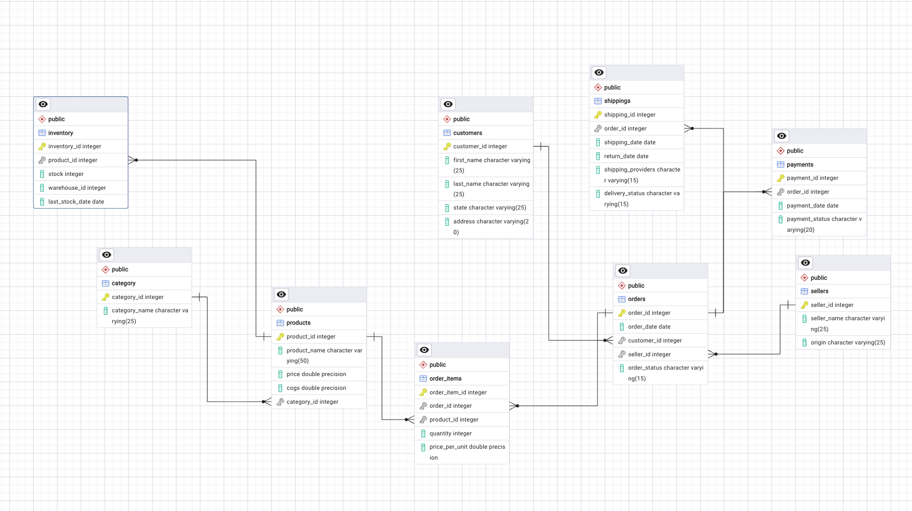

# Amazone_SQL Project - Advanced SQL Data Analysis

## Project Description

This project analyzes an Amazon-style e-commerce dataset using advanced SQL in PostgreSQL. The goal is to transform raw sales data into meaningful business insights related to products, customers, sellers, categories, payments, shipping, inventory, returns, and revenue performance.

The project includes:
- Creating a relational database schema
- Loading CSV data into PostgreSQL
- Performing exploratory data analysis (EDA)
- Solving real-world business problems using SQL
- Using advanced SQL concepts such as joins, aggregate functions, window functions, CTEs, and subqueries
- Creating a PL/pgSQL stored procedure to automate sales processing and inventory updates

This project demonstrates the ability to work with a relational database, clean and prepare data, write analytical SQL queries, and generate business insights from e-commerce data.

## Project Objectives

The main objectives of this project are:
- Build a relational database for an Amazone-style e-commerce business
- Load CSV data into PostgreSQL tables
- Explore and validate the data using SQL
- Calculate total sales, revenue, profit, and customer lifetime value
- Identify top-selling products, categories, sellers, and customers
- Analyze monthly sales trends and year-over-year revenue changes
- Identify low-stock products and inactive sellers
- Analyze shipping delays and shipping-provider performance
- Calculate payment success rates and product return rates
- Create a stored procedure to add sales and automatically update inventory

  ## Tools and Technologies
  |Tool/Technology|Purpose|
  |--------|-------|
  |PostgreSQL | Relational database management system|
  |pgAdmin 4 | Database management and query execution|
  |SQL | Data querying and analysis |
  |PL/pgSQL | Stored procedure development |
  |CSV files | Source data |
  |Github | Project documentation and version control |

  ## Database Schema

The database contains nine main tables:

| Table | Description |
|-------|-------|
| `category` | Stores product category information |
| `customers` | Stores customer details, including name, state, and address |
| `sellers` | Stores seller information |
| `products` | Stores product details, price, cost of goods sold, and category |
| `orders` | Stores order-level information |
| `order_items` | Stores individual products purchased in each order |
| `payments` | Stores payment information for orders |
| `shippings` | Stores shipping provider, shipping date, return date, and delivery status |
| `inventory` | Stores product stock levels, warehouse ID, and last stock date |

## ERD Diagram

The ERD diagram below shows the relationships between the database tables.

Foreign keys connect related tables and ensure referential integrity across the database.



## Project Workflow

### Step 1: Create the Database

1. Open pgAdmin 4.
2. Create a new PostgreSQL database, for example `amazone_project`.
3. Open the Query Tool.
4. Run the table-creation SQL script.

### Step 2: Create Tables

The following tables were created:

```sql
category
customers
sellers
products
orders
order_items
payments
shippings
inventory
```
### Step 3: Import CSV Files Using pgAdmin

After creating all tables, the CSV files were imported into PostgreSQL using the **Import/Export Data** feature in pgAdmin 4.
The following CSV files were imported:

| CSV File | Target Table |
|-------|-------|
| `category.csv` | `category` |
| `customers.csv` | `customers` |
| `sellers.csv` | `sellers` |
| `products.csv` | `products` |
| `orders.csv` | `orders` |
| `order_items.csv` | `order_items` |
| `payments.csv` | `payments` |
| `shippings.csv` | `shippings` |
| `inventory.csv` | `inventory` |

## Total Sale Calculation

A new column called `total_sale` was added to the `order_items` table.

```sql
-- Creating new column
ALTER TABLE order_items
ADD COLUMN total_sale FLOAT;

-- updating price (qty * price per unit)
UPDATE order_items
SET total_sale = quantity * price_per_unit;

```
The formula is:
```text
total_sale = quantity * price_per_unit
```

This column is used in most revenue, sales, customer_value, seller_performance, and profit-margin queries.

## Business Problems and SQL Solutions

This project solves real-world e-commerce business problems using SQL. Each analysis identifies a business question, explain the approach, and provides an SQL solution.

### 1. Top Selling Products

**Business Problem:**
The business needs to identify its top 10 products based on total sales value. This helps management understand which products generate the most revenue and should receive more marketing or inventory attention.

**Business Value:**
This analysis identifies best-selling products, supports inventory planning, and helps prioritize products for promotions.

```sql
SELECT 
	p.product_id,
	p.product_name,
	SUM(oi.total_sale) AS total_sale,
	COUNT(o.order_id) AS total_orders
FROM orders AS o
INNER JOIN order_items AS oi
	ON o.order_id = oi.order_id
INNER JOIN products AS p
	ON p.product_id = oi.product_id
GROUP BY 1, 2
ORDER BY SUM(oi.total_sale) DESC
LIMIT 10
;
```
### 2. Revenue by Category

**Business Problem:**
The business needs to understand how much revenue each product category generates and how much each category contributes to total revenue.

**Business Value:**  
This helps identify the most profitable categories and supports category-level business decisions.

```sql
SELECT 
	p.category_id,
	ca.category_name,
	ROUND(SUM(oi.total_sale)::numeric, 2) AS total_revenue,
	CONCAT(ROUND((SUM(oi.total_sale)/ 
		(SELECT SUM(total_sale) FROM order_items) * 100)::numeric, 2),'%')
		AS contribution
FROM order_items oi
INNER JOIN products p
	ON p.product_id = oi.product_id
LEFT JOIN category ca
	ON p.category_id = ca.category_id
GROUP BY 1, 2
ORDER BY 3 DESC
;
```
### 3. Average Order Value

**Business Problem:**  
The business wants to identify high-value customers by calculating the average order value for each customer. Only customers with more than five orders were included.

**Business Value:**  
This analysis helps identify loyal and high-spending customers for targeted marketing and customer-retention strategies.

```sql
SELECT
	c.customer_id,
	CONCAT(c.first_name,' ',c.last_name) AS customer_name,
	SUM(oi.total_sale)/COUNT(o.order_id) AS avg_order_value,
	COUNT(o.order_id) AS total_orders
FROM orders AS o
INNER JOIN customers AS c
	ON c.customer_id = o.customer_id
INNER JOIN order_items AS oi
	ON oi.order_id = o.order_id
GROUP BY 1,2
HAVING COUNT(o.order_id) > 5
;
```
### 4. Monthly Sales Trend

**Business Problem:**  
The business needs to understand monthly sales performance and compare each month with the previous month.

**Business Value:**  
This helps identify sales growth or decline over time and supports monthly sales forecasting.

```sql
SELECT
	year,
	month,
	overall_total_sales,
	LAG(overall_total_sales, 1) OVER(ORDER BY year, month) AS last_month_sale
FROM
(SELECT 
	EXTRACT(MONTH FROM order_date) AS month,
	EXTRACT(YEAR FROM order_date) AS year,
	ROUND(
		SUM(oi.total_sale)::numeric
		, 3) AS overall_total_sales
FROM orders as o
JOIN order_items oi
	ON o.order_id = oi.order_id
WHERE order_date >= CURRENT_DATE - INTERVAL '3 year'
GROUP BY 1, 2
ORDER BY year, month
) AS query_1
;
```
### 5. Customers With No Purchases

**Business Problem:**  
The business needs to identify registered customers who have never placed an order.

**Business Value:**  
This helps identify inactive customers who may need promotional emails, discounts, or re-engagement campaigns.

```sql
-- Solution 1
SELECT *
-- reg_date - CURRENT_DATE
FROM customers
WHERE customer_id NOT IN
(
SELECT 
	DISTINCT customer_id
FROM orders
);

-- Solution 2
SELECT *
FROM customers AS c
LEFT JOIN orders AS o
	ON o.customer_id = c.customer_id
WHERE o.customer_id IS NULL
;
```
### 6. Best-Selling Categories by State

**Business Problem:**  
The business needs to identify the best-selling product category in each customer state.

**Business Value:**  
This helps understand regional customer preferences and supports location-based marketing and inventory planning.

```sql
WITH ranking_table
AS
(
SELECT 
	c.state,
	cg.category_name,
	ROUND(SUM(oi.total_sale)::numeric, 2) AS total_sales,
	RANK() OVER(PARTITION BY c.state ORDER BY ROUND(SUM(oi.total_sale)::numeric, 2) DESC) AS rank
FROM orders AS o
INNER JOIN customers AS c
	ON o.customer_id = c.customer_id
INNER JOIN order_items AS oi
	ON oi.order_id = o.order_id
INNER JOIN products AS p
	ON oi.product_id = p.product_id
INNER JOIN category AS cg
	ON p.category_id = cg.category_id
GROUP BY 1, 2
-- ORDER BY 1, 3 DESC
)
SELECT *
FROM ranking_table
WHERE rank = 1;
```
### 7. Customer Lifetime Value

**Business Problem:**  
The business needs to calculate the total value of orders placed by each customer and rank customers based on their lifetime value.

**Business Value:**  
This helps identify the most valuable customers and supports customer-loyalty and retention programs.

```sql
SELECT 
	c.customer_id,
	CONCAT(c.first_name,' ',c.last_name) AS full_name,
	ROUND(SUM(oi.total_sale)::numeric, 2) AS CLTV,
	DENSE_RANK() OVER(ORDER BY ROUND(SUM(oi.total_sale)::numeric, 2) DESC) AS cx_ranking
FROM orders AS o
INNER JOIN customers AS c
	ON o.customer_id = c.customer_id
INNER JOIN order_items AS oi
	ON o.order_id = oi.order_id
GROUP BY 1, 2
ORDER BY 3 DESC
;
```

### 8. Inventory Stock Alerts

**Business Problem:**  
The business needs to identify products with low stock levels to avoid stockouts.

**Business Value:**  
This helps inventory teams reorder products before stock runs out.

```sql
SELECT 
	iv.product_id, 
	p.product_name,
	iv.stock,
	iv.warehouse_id,
	iv.last_stock_date
FROM inventory AS iv
INNER JOIN products AS p
	ON iv.product_id = p.product_id
WHERE stock < 10;
```

### 9. Shipping Delays

**Business Problem:**  
The business needs to identify orders where shipping took more than three days after the order date.

**Business Value:**  
This helps identify shipping delays, improve delivery performance, and monitor shipping-provider reliability.

```sql
SELECT 
	c.*,
	o.*,
	sp.shipping_providers,
	sp.shipping_date - o.order_date AS days_took_to_ships
FROM customers AS c
INNER JOIN orders AS o
	ON c.customer_id = o.customer_id
INNER JOIN shippings AS sp
	ON sp.order_id = o.order_id
WHERE sp.shipping_date - o.order_date > 3
;
```

### 10. Payment Success Rate

**Business Problem:**  
The business needs to understand the distribution and percentage of payment statuses, such as completed, failed, and pending payments.

**Business Value:**  
This helps monitor payment performance and identify issues with failed or pending payments.

```sql
SELECT 
	p.payment_status,
	COUNT(*) AS total_count,
	CONCAT(ROUND(COUNT(*)/(SELECT COUNT(*) FROM payments)::numeric * 100, 2),'%') AS rate
FROM orders o
INNER JOIN payments AS p
	ON o.order_id = p.order_id
GROUP BY 1
;

```

### 11. Top Performing Sellers

**Business Problem:**  
The business needs to identify the top five sellers based on total sales and evaluate their order-success rate.

**Business Value:**  
This helps identify high-performing sellers and monitor seller order-completion performance.

```sql
WITH top_sellers
AS
(
-- retrieve top 5 sellers
SELECT 
	s.seller_id,
	s.seller_name,
	ROUND(SUM(oi.total_sale)::numeric, 2) AS total_sales
FROM orders AS o
INNER JOIN sellers AS s
	ON s.seller_id = o.seller_id
INNER JOIN order_items AS oi
	ON oi.order_id = o.order_id
GROUP BY 1, 2
ORDER BY 3 DESC
LIMIT 5
),
order_status_count AS
( -- order_status based on the sellers
SELECT 
	o.seller_id,
	ts.seller_name,
	o.order_status,
	COUNT(*) AS total_order
FROM orders AS o
INNER JOIN top_sellers AS ts
	ON ts.seller_id = o.seller_id
WHERE o.order_status NOT IN ('Inprogress', 'Returned')
GROUP BY 1, 2, 3
)

SELECT 
	seller_id,
	seller_name,
	SUM(CASE WHEN order_status = 'Completed' THEN total_order ELSE 0 END) AS completed_orders,
	SUM(CASE WHEN order_status = 'Cancelled' THEN total_order ELSE 0 END) AS cancelled_orders,
	SUM(total_order) AS total_orders, 
	CONCAT(ROUND(SUM(CASE WHEN order_status = 'Completed' THEN total_order ELSE 0 END)::numeric/
	SUM(total_order)::numeric * 100, 0), '%') AS successful_orders_ratio
	
FROM order_status_count
GROUP BY 1,2 
ORDER BY 1
;
```
### 12. Product Profit Margin

**Business Problem:**  
The business needs to calculate the profit margin for each product and identify the most profitable products.

**Business Value:**  
This helps identify high-profit products and supports pricing and product-strategy decisions.

```sql
SELECT
	product_id,
	product_name,
	profit_margin,
	DENSE_RANK() OVER(ORDER BY profit_margin DESC) AS product_ranking
FROM
(SELECT 
	p.product_id,
	p.product_name,
	ROUND(SUM(oi.total_sale - (p.cogs * oi.quantity))::numeric, 2) AS profit,
	ROUND(SUM(oi.total_sale - (p.cogs * oi.quantity))::numeric, 2)/SUM(oi.total_sale)*100 AS profit_margin
FROM order_items AS oi
INNER JOIN products AS p
	ON p.product_id = oi.product_id
GROUP BY 1, 2
) AS profit_table
;
```

### 13. Most Returned Products

**Business Problem:**  
The business needs to identify products with the highest number of returns and calculate the return rate.

**Business Value:**  
This helps identify products with quality, description, sizing, or customer-satisfaction issues.

```sql
SELECT 
	p.product_id,
	p.product_name,
	COUNT(o.order_id) AS total_unit_sold,
	SUM(CASE WHEN o.order_status = 'Returned' THEN 1 ELSE 0 END) AS total_returned,
	ROUND(SUM(CASE WHEN o.order_status = 'Returned' THEN 1 ELSE 0 END)::numeric/COUNT(*)::numeric * 100, 0) AS retrun_percentage
FROM order_items AS oi
INNER JOIN products AS p
	ON oi.product_id = p.product_id
INNER JOIN orders AS o
	ON oi.order_id = o.order_id
GROUP BY 1,2 
ORDER BY 5 DESC
;
```
### 15. Inactive Sellers

**Business Problem:**  
The business needs to identify sellers who have not made any sales in the last six months.

**Business Value:**  
This helps identify inactive sellers and support seller-engagement or reactivation strategies.

```sql
WITH sellers_cte1-- as these sellers who haven't made any sales in the last 6 months.
AS
(
SELECT *
FROM sellers
WHERE seller_id NOT IN
	(SELECT seller_id 
	FROM orders 
	WHERE order_date >= CURRENT_DATE - INTERVAL '6 month')
) 
SELECT
  o.seller_id,
  cte1.seller_name,
  MAX(o.order_date) max_sale_date,
  ROUND(oi.total_sale::numeric, 2) AS last_total_sale
FROM orders AS o
INNER JOIN sellers_cte1 AS cte1
	ON o.seller_id = cte1.seller_id
INNER JOIN order_items As oi
	ON oi.order_id = o.order_id
GROUP BY 1, 2, 4
;

```

### 16. Returning and New Customers

**Business Problem:**  
The business needs to classify customers as returning or new based on the number of returned orders.

**Business Value:**  
This helps understand customer behavior and identify customers with repeated return activity.

```sql
SELECT 
	full_name,
	total_orders,
	total_return,
	CASE 
		WHEN total_return > 5 THEN 'Returning_customers' ELSE 'NEW'
	END AS cx_category
FROM
(SELECT 
	CONCAT(c.first_name,' ', c.last_name) AS full_name,
	COUNT(o.order_id) AS total_orders,
	SUM(CASE WHEN o.order_status = 'Returned' THEN 1 ELSE 0 END) AS total_return
	
FROM orders AS o
INNER JOIN customers AS c
	ON o.customer_id = c.customer_id
INNER JOIN order_items AS oi
	ON o.order_id = oi.order_id
GROUP BY 1
)
;
```

### 17. Top Five Customers by Orders in Each State

**Business Problem:**  
The business needs to identify the top five customers with the highest number of orders in each state.

*Business Value:**  
This helps identify key customers in each region and supports regional marketing campaigns.

```sql
SELECT *
FROM
(SELECT 
	o.customer_id,
	CONCAT(cu.first_name,' ',cu.last_name) AS full_name,
	cu.state,
	COUNT(o.order_id) AS total_orders,
	SUM(oi.total_sale) AS total_sales,
	DENSE_RANK() OVER(PARTITION BY cu.state ORDER BY COUNT(o.order_id) DESC) AS rank
FROM orders o
INNER JOIN order_items AS oi
	ON oi.order_id = o.order_id
INNER JOIN customers AS cu
	ON cu.customer_id = o.customer_id
GROUP BY 1,2, 3
) AS t1
WHERE rank <=5
;
```

### 18. Revenue by Shipping Provider

**Business Problem:**  
The business needs to evaluate the revenue handled by each shipping provider, the number of orders handled, and the average delivery time.

**Business Value:**  
This helps compare shipping-provider performance and identify providers with longer delivery times.

```sql
SELECT
	sp.shipping_providers,
	COUNT(o.order_id) AS order_handled,
	SUM(oi.total_sale) AS total_sales,
	ROUND(COALESCE(AVG(sp.return_date - sp.shipping_date),0), 0) AS average_days
FROM orders AS o
INNER JOIN order_items AS oi
	ON o.order_id = oi.order_id
INNER JOIN shippings AS sp
	ON sp.order_id = o.order_id
GROUP BY 1
;
```

### 19. Products With Highest Revenue Decrease

**Business Problem:**  
The business needs to identify products whose revenue decreased the most from 2022 to 2023.

**Business Value:**  
This helps identify products with declining sales and supports product-performance reviews and inventory decisions.

```sql
WITH last_year_sale 
AS
(SELECT 
	p.product_id,
	p.product_name,
	SUM(oi.total_sale) AS revenue
FROM orders AS o
INNER JOIN order_items AS oi
	ON o.order_id = oi.order_id
INNER JOIN products AS p
	ON p.product_id = oi.product_id
WHERE EXTRACT(YEAR FROM o.order_date) = 2022
GROUP BY 1,2
)
,
current_year_sale
AS
(SELECT 
	p.product_id,
	p.product_name,
	SUM(oi.total_sale) AS revenue
FROM orders AS o
INNER JOIN order_items AS oi
	ON o.order_id = oi.order_id
INNER JOIN products AS p
	ON p.product_id = oi.product_id
WHERE EXTRACT(YEAR FROM o.order_date) = 2023
GROUP BY 1,2
)
SELECT 
	cs.product_id,
	cs.product_name,
	ROUND(ls.revenue::numeric, 2) AS last_year_revenue,
	ROUND(cs.revenue::numeric, 2) AS current_year_revenue,
	ROUND(ls.revenue::numeric - cs.revenue::numeric, 2) AS rev_diff,
	ROUND((cs.revenue - ls.revenue)::numeric/ls.revenue::numeric * 100, 2) AS revenue_dec_ratio
FROM last_year_sale ls
INNER JOIN current_year_sale cs
	ON ls.product_id = cs.product_id
WHERE ls.revenue > cs.revenue
ORDER BY 5 DESC
LIMIT 10
;

## Stored Procedure Problem and Solution

**Business Problem:**  
When a customer purchases a product, the business needs to automatically create the order, record the order item, and reduce the available inventory stock.
```

**Business Value:**  
This automates the sales process, reduces manual inventory updates, and helps prevent selling products with insufficient stock.

```sql
CREATE OR REPLACE PROCEDURE add_sales
(
	p_order_id INT,
	p_customer_id INT,
	p_seller_id INT,
	p_order_item_id INT,
	p_product_id INT,
	p_quantity INT

)
LANGUAGE plpgsql
AS $$

DECLARE 
-- all variable
v_count INT;
v_price FLOAT;
v_product VARCHAR(50);

BEGIN
-- Fetching product name and price based p id entered
	SELECT 
		price, product_name
	INTO 
		v_price, v_product
	FROM products 
	WHERE product_id = p_product_id;

-- checking stock and product availabity in inventory
	SELECT 
		COUNT(*)
		INTO
		v_count
	FROM inventory
	WHERE product_id = p_product_id
	AND stock >= p_quantity;
	
	IF v_count > 0 THEN
	-- ADD into orders and order_items table
	-- update inventory
	INSERT INTO orders(order_id, order_date, customer_id, seller_id)
	VALUES
	(p_order_id, CURRENT_DATE, p_customer_id, p_seller_id);
	
	-- adding into order list
	INSERT INTO order_items(order_item_id, order_id, product_id, quantity, price_per_unit, total_sale)
	VALUES
	(p_order_item_id,p_order_id,p_product_id,p_quantity, v_price, v_price*p_quantity);

	-- updating inventory
	UPDATE inventory
	SET stock = stock - p_quantity
	WHERE product_id = p_product_id;

	RAISE NOTICE 'Thank you. The product % has been added and inventory stock updated.', v_product; 
	
	ELSE
		RAISE NOTICE 'Thank you for your info the product % is not available', v_product;
		
	END IF;


END;
$$

-- ordering the produce with desire quantity

call add_sales

(
	25005, 2, 5, 25004, 1, 14
);

```

## Conclusion

This project demonstrates how SQL can be used to analyze an e-commerce business database and generate actionable business insights.

By combining relational database design, CSV data import, exploratory analysis, advanced SQL queries, and stored procedures, the project provides a complete end-to-end data-analysis workflow.

The analysis helps identify top-performing products, valuable customers, successful sellers, low-stock inventory, shipping delays, payment performance, and revenue changes over time.

The stored procedure also demonstrates how SQL can be used beyond reporting by automating business processes such as adding sales records and updating inventory stock.

## How to Run This Project

1. Install PostgreSQL and pgAdmin 4.
2. Create a new PostgreSQL database.
3. Run `create_tables.sql` to create all tables.
4. Import each CSV file into its matching table using pgAdmin’s **Import/Export Data** feature.
5. Run `Query_Q&Solutions.sql` to perform EDA and business analysis.
6. Run the stored procedure script.
7. Test the procedure using `CALL add_sales();`.

## Author

Created as a portfolio project to demonstrate SQL, PostgreSQL, database design, data analysis, and PL/pgSQL skills.

